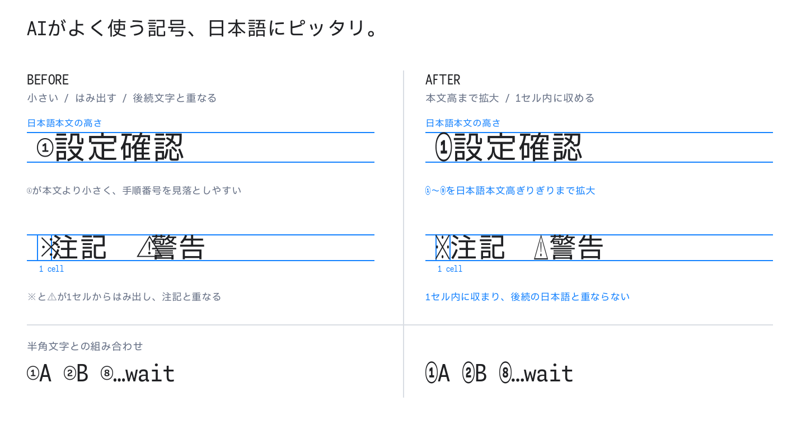

# Agentic Mono JP

GitHub Copilot CLIやClaude Codeの出力を、日本語ターミナルで読みやすくする
プログラミングフォントです。

日本語フォントでは、AI CLIがよく使う`①`〜`⑨`、`※`、`⚠`、`…`が細すぎたり、
2セル幅になったりして、手順が見づらく後続文字もずれることがあります。
Agentic Mono JPは[Moralerspace Neon HW v2.0.0](https://github.com/yuru7/moralerspace)
をベースに、問題のある12字だけを半角1セルへ最適化します。それ以外の字形は
原本のままです。

## Before / After



## インストール

[最新のRelease](https://github.com/nnasaki/agentic-mono-jp/releases/latest)からZIPを
ダウンロードし、展開した4ファイルをインストールします。

```text
AgenticMonoJP-Regular.ttf
AgenticMonoJP-Bold.ttf
AgenticMonoJP-Italic.ttf
AgenticMonoJP-BoldItalic.ttf
```

### macOS

4ファイルを選択してダブルクリックし、Font Bookで「インストール」を選びます。
手動で配置する場合は、現在のユーザーだけで使うなら`~/Library/Fonts/`、
すべてのユーザーで使うなら`/Library/Fonts/`へコピーします。

### Windows

4ファイルを選択して右クリックし、「インストール」または
「すべてのユーザーに対してインストール」を選びます。設定画面を使う場合は
「設定 > 個人用設定 > フォント」へ4ファイルをドラッグ&ドロップします。

ターミナルまたはAI CLIのfont設定で **Agentic Mono JP** を選択してください。

既存のMoralerspace Neon HWとは別familyとして共存できます。

## 解決する表示問題

| 文字 | 問題 | Agentic Mono JP |
| --- | --- | --- |
| `①`〜`⑨` | 通常ウェイトでは細く、手順番号が本文に埋もれる | Bold系の輪郭を使い、1セル内で大きく表示 |
| `※` | 全角幅になり、注記の後ろがずれる | 日本語本文と釣り合う高さで1セル化 |
| `⚠` | 2セル幅になり、後続文字と衝突する | 警告記号の形を保って1セル化 |
| `…` | Italic系でセルからはみ出す | 低い句読位置を保ったまま1セル化 |

`●`、`○`、`✓`、`✗`、`→`は原本ですでに1セルへ収まるため変更していません。
`⓪`、`⑩`〜`⑳`、`❶`〜`❾`など、対象外のglyphも原本と一致します。

## ソースからビルド

次の原本4styleを`~/Library/Fonts/`へ用意します。

```text
MoralerspaceNeonHW-Regular.ttf
MoralerspaceNeonHW-Bold.ttf
MoralerspaceNeonHW-Italic.ttf
MoralerspaceNeonHW-BoldItalic.ttf
```

```bash
python3 -m venv .venv
.venv/bin/pip install -r requirements.txt
.venv/bin/python make.py build
```

原本は読み取り専用で扱い、上書き・移動・削除しません。

## 検証

```bash
.venv/bin/python -m unittest discover -s tests -v
.venv/bin/python verify.py build
.venv/bin/python verify.py build --control
.venv/bin/python render_sample.py build
```

検証では対象glyphの幅・形状・source style、対象外glyphのidentity、name table、
比較PNGを確認します。

## アンインストール

Agentic Mono JPだけを削除します。原本は変更しません。

```bash
rm ~/Library/Fonts/AgenticMonoJP-{Regular,Bold,Italic,BoldItalic}.ttf
```

## ライセンス

**License: [SIL Open Font License 1.1 (OFL-1.1)](LICENSE)**

Reserved Font Nameは **Agentic Mono JP** です。著作権表示と派生元のライセンスは
[`LICENSE`](LICENSE)と[`THIRD_PARTY_NOTICES.md`](THIRD_PARTY_NOTICES.md)を参照してください。
